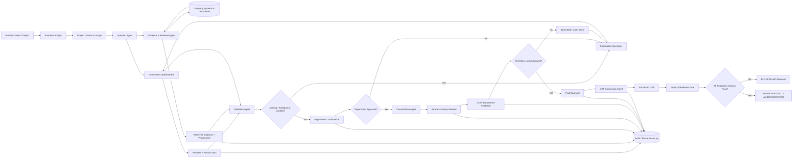

# Baspin System Architecture

## Purpose

Baspin is designed as a human-in-the-loop business analysis and knowledge validation system. Its purpose is to help a Business Analyst collect the right information from the right people and company systems, detect missing or conflicting knowledge, obtain accountable human confirmation, and transform only validated knowledge into structured OKF.

The architecture follows one core rule:

> **AI gathers, compares, structures, and recommends. Humans verify and approve. The Business Analyst owns the analysis process, not the invention of source information.**

This creates a check-and-balance model in which no critical business requirement becomes project-ready without source traceability, responsible ownership, and explicit approval.

---

## Core Actors

### 1. Business Analyst
- Creates the project context, scope, and objectives.
- Reviews AI-generated questions before or during collection.
- Reviews validated departmental inputs.
- Resolves business-level trade-offs with stakeholders.
- Performs the final analytical review before project approval.

### 2. Department Stakeholders / Knowledge Owners
- Provide domain-specific answers.
- Review information collected from company systems.
- Clarify missing or ambiguous information.
- Confirm, reject, or request changes to requirements that belong to their domain.

### 3. Baspin AI Agents
Baspin may use several specialized agents rather than one unrestricted agent.

#### Question Agent
- Generates department-specific questions from project context.
- Produces follow-up questions based on prior answers.
- Avoids asking irrelevant questions already answered by trusted sources.

#### Evidence & Retrieval Agent
- Collects relevant information from approved company sources.
- Associates every extracted fact with provenance.
- Does not treat retrieved information as approved merely because it exists in a system.

#### Validation Agent
- Compares answers, documents, policies, APIs, and other evidence.
- Detects missing information, inconsistencies, ambiguity, and conflicts.
- Generates clarification questions.

#### Consolidation Agent
- Combines only validated departmental knowledge into a cross-functional analysis.
- Preserves department ownership, source, approval status, and unresolved issues.

#### OKF Conversion Agent
- Converts approved business knowledge into structured OKF.
- Does not overwrite unresolved disagreements.
- Preserves provenance and approval metadata where applicable.

#### Readiness Agent / Gate
- Checks whether all mandatory approvals and requirements are complete.
- Returns READY only when no blocking item remains.
- Returns BLOCKED with explicit reasons when critical items remain unresolved.

---

## Company Information Sources

Baspin can collect evidence from approved enterprise systems such as:

- Databases
- Policy documents
- SOPs and procedures
- Existing APIs
- CRM / ERP / claims systems
- Confluence or other knowledge bases
- Previous project tickets
- Regulatory documents
- Emails or approved communication archives

Every extracted item should carry provenance metadata such as:

- source system
- source document or record
- timestamp
- department owner
- person who supplied or confirmed it
- approval status

---

## Human Approval Model

Critical knowledge moves through explicit states:

`Collected -> Unverified -> Needs Clarification -> Department Confirmed -> Cross-Department Validated -> Final Approved`

Possible decision states include:

- Pending
- Approved
- Rejected
- Needs Clarification
- Superseded

A requirement cannot be treated as final simply because an AI inferred it or found it in an existing document.

---

## Conflict Detection Example

Example:

- Policy document: automatic claim approval limit = $20,000
- Claims Manager: current operational limit = $25,000

Baspin must not silently choose one value.

It should create a conflict object, identify the responsible owner, ask a clarification question, store the resolution, and preserve the evidence trail.

Example clarification:

> The current policy states $20,000 while Claims Operations reports $25,000. Which value should govern the new system, and does the policy require an update?

---

## Architecture Flow

---

## Logical Architecture Layers

### Layer 1 — Interaction
- Business Analyst workspace
- Department response portal
- Approval interface
- Project status dashboard

### Layer 2 — Orchestration
- Workflow engine
- State machine
- Task routing
- Reminder and escalation logic

### Layer 3 — AI Services
- Question generation
- Retrieval support
- Conflict detection
- Gap analysis
- Consolidation
- OKF conversion
- Readiness evaluation

### Layer 4 — Knowledge & Evidence
- Raw answers
- Retrieved evidence
- Requirement objects
- Conflict objects
- Approval records
- Provenance records
- OKF artifacts

### Layer 5 — Enterprise Connectors
- APIs
- Databases
- document stores
- ticketing systems
- knowledge bases
- enterprise applications

### Layer 6 — Governance & Audit
- Access control
- role permissions
- approval authority
- immutable event history
- provenance
- change tracking

---

## Check-and-Balance Controls

Baspin should enforce the following controls:

1. **No source, no fact** — important claims must preserve their source.
2. **No owner, no requirement** — critical requirements must have a responsible business owner.
3. **No silent conflict resolution** — conflicting evidence must be escalated.
4. **No AI self-approval** — AI-generated conclusions cannot approve themselves.
5. **No premature OKF finalization** — only validated knowledge can become final OKF.
6. **No execution with blockers** — unresolved critical approvals keep the project BLOCKED.
7. **Every decision is traceable** — approvals, changes, and superseded answers remain auditable.

---

## Project Readiness Gate

A project may reach `READY FOR DELIVERY` only when all required checks pass, for example:

- Business requirements approved
- Data requirements approved
- Compliance approved
- Legal approved
- Security approved
- Finance approved where applicable
- Technical feasibility reviewed
- Required department owners approved
- No unresolved critical conflicts
- OKF generated from approved knowledge

Otherwise the project remains `BLOCKED`, with explicit blocking reasons and responsible owners.

---

## Architecture Principle

Baspin is not an autonomous system that invents company truth.

It is an orchestration, validation, and traceability layer between the Business Analyst, enterprise knowledge sources, domain experts, and AI agents.

The system should make organizational knowledge easier to collect and structure while making responsibility clearer, not weaker.
