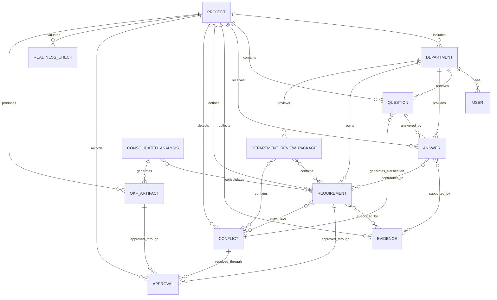

# Baspin Data Model

## Purpose

The Baspin data model is designed to preserve traceability, accountability, approval history, and source provenance across the full business analysis lifecycle.

The central rule is:

> **No important business statement should exist without knowing where it came from, who owns it, whether it was challenged, and who approved it.**

This model supports the check-and-balance architecture defined in the product and system architecture documents.

---

## Core Entities

### 1. Project
Represents a business initiative being analyzed in Baspin.

Key fields:
- `id`
- `name`
- `description`
- `business_goal`
- `scope`
- `status`
- `business_analyst_id`
- `created_at`
- `updated_at`

Example statuses:
- Draft
- Collecting
- Validation
- Cross-Department Review
- Final Approval
- OKF Ready
- Ready for Delivery
- Blocked

---

### 2. Department
Represents an organizational unit involved in the project.

Key fields:
- `id`
- `name`
- `description`
- `project_id`
- `owner_user_id`
- `is_required_for_readiness`

Examples:
- Claims
- Finance
- Legal
- Compliance
- Security
- IT
- Customer Service

---

### 3. User / Stakeholder
Represents a person participating in the workflow.

Key fields:
- `id`
- `name`
- `email`
- `role`
- `department_id`
- `approval_authority`

Possible roles:
- Business Analyst
- Department Contributor
- Department Owner
- Legal Approver
- Compliance Approver
- Security Approver
- Project Sponsor

---

### 4. Question
Represents a question generated by the AI or entered by the Business Analyst.

Key fields:
- `id`
- `project_id`
- `department_id`
- `text`
- `question_type`
- `generated_by`
- `parent_question_id`
- `status`
- `created_at`

Question types may include:
- Initial
- Follow-up
- Clarification
- Conflict Resolution
- Approval Confirmation

---

### 5. Answer
Represents a response provided by a stakeholder.

Key fields:
- `id`
- `question_id`
- `project_id`
- `department_id`
- `provided_by_user_id`
- `answer_text`
- `status`
- `created_at`
- `updated_at`

Suggested statuses:
- Draft
- Submitted
- Unverified
- Needs Clarification
- Confirmed
- Rejected
- Superseded

---

### 6. Evidence
Represents supporting information retrieved from a company source or attached by a stakeholder.

Key fields:
- `id`
- `project_id`
- `source_type`
- `source_name`
- `source_reference`
- `content_excerpt`
- `retrieved_at`
- `retrieved_by`
- `department_id`
- `verification_status`

Source types may include:
- Database
- API
- Policy Document
- SOP
- Ticket
- Knowledge Base
- Email
- Regulatory Document
- Uploaded File

Important: retrieved evidence is not automatically treated as approved truth.

---

### 7. Requirement
Represents a normalized business requirement derived from one or more answers and evidence items.

Key fields:
- `id`
- `project_id`
- `department_id`
- `title`
- `description`
- `requirement_type`
- `priority`
- `status`
- `owner_user_id`
- `created_from_answer_ids`
- `created_from_evidence_ids`
- `created_at`
- `updated_at`

Requirement types may include:
- Business Rule
- Functional Requirement
- Non-Functional Requirement
- Data Requirement
- Compliance Requirement
- Security Requirement
- Process Requirement
- Integration Requirement

Suggested statuses:
- Proposed
- Under Review
- Needs Clarification
- Department Approved
- Cross-Department Approved
- Final Approved
- Rejected
- Superseded

---

### 8. Conflict
Represents a contradiction between answers, evidence, requirements, or departments.

Key fields:
- `id`
- `project_id`
- `conflict_type`
- `description`
- `severity`
- `status`
- `owner_department_id`
- `owner_user_id`
- `related_answer_ids`
- `related_evidence_ids`
- `related_requirement_ids`
- `resolution_text`
- `resolved_by_user_id`
- `resolved_at`

Suggested conflict statuses:
- Open
- Under Review
- Waiting for Clarification
- Resolved
- Accepted Risk

Critical conflicts block readiness.

---

### 9. Approval
Represents an explicit human decision on a requirement, department package, or final project state.

Key fields:
- `id`
- `project_id`
- `target_type`
- `target_id`
- `approver_user_id`
- `department_id`
- `decision`
- `comment`
- `approved_at`
- `version`

Decision values:
- Approved
- Rejected
- Needs Clarification
- Abstained

Target types may include:
- Answer
- Requirement
- Department Package
- Final Analysis
- OKF Artifact
- Project Readiness

---

### 10. Provenance Record
Represents the chain of origin and transformation for a piece of business knowledge.

Key fields:
- `id`
- `project_id`
- `entity_type`
- `entity_id`
- `source_entity_type`
- `source_entity_id`
- `action`
- `performed_by`
- `timestamp`

Example actions:
- Retrieved
- Submitted
- Normalized
- Consolidated
- Revised
- Approved
- Rejected
- Superseded
- Converted to OKF

This should support a full audit trail.

---

### 11. Department Review Package
Represents the set of validated requirements and open issues sent to a department owner for confirmation.

Key fields:
- `id`
- `project_id`
- `department_id`
- `requirement_ids`
- `open_conflict_ids`
- `status`
- `submitted_at`
- `reviewed_at`

Suggested statuses:
- Draft
- Sent for Review
- Needs Clarification
- Approved
- Rejected

---

### 12. Consolidated Analysis
Represents the Business Analyst's cross-department analysis after department-level validation.

Key fields:
- `id`
- `project_id`
- `summary`
- `requirement_ids`
- `open_issue_ids`
- `risk_summary`
- `assumptions`
- `dependencies`
- `status`
- `version`

---

### 13. OKF Artifact
Represents structured knowledge produced from approved analysis.

Key fields:
- `id`
- `project_id`
- `version`
- `schema_version`
- `content`
- `generated_from_analysis_id`
- `generated_at`
- `status`

Suggested statuses:
- Draft
- Validation Required
- Approved
- Superseded

The OKF artifact must preserve references to approved source requirements and provenance.

---

### 14. Readiness Check
Represents one condition used to determine whether the project is ready for delivery.

Key fields:
- `id`
- `project_id`
- `check_type`
- `required`
- `status`
- `blocking_reason`
- `owner_department_id`
- `owner_user_id`
- `evaluated_at`

Example check types:
- Business Requirements
- Data Requirements
- Legal
- Compliance
- Security
- Finance
- Technical Feasibility
- Stakeholder Approval
- Critical Conflict Resolution
- OKF Approval

Statuses:
- Pass
- Fail
- Pending
- Not Applicable

---

## Relationship Overview



---

## Knowledge Lifecycle

A business fact should move through a controlled lifecycle:

```text
Raw Input / Retrieved Evidence
        ↓
Unverified Knowledge
        ↓
Validation
        ↓
Clarification or Conflict Resolution
        ↓
Department Confirmation
        ↓
Normalized Requirement
        ↓
Cross-Department Validation
        ↓
Final Approval
        ↓
OKF Representation
        ↓
Readiness Gate
```

---

## Example Traceability Chain

Example requirement:

> Claims over $25,000 require supervisor approval.

Traceability could be stored as:

```text
Project: Automated Claims Approval
Department: Claims
Question: What claim amount requires manual approval?
Answer: $25,000
Provided by: Claims Manager
Evidence: Claims Operations SOP v3.1
Conflict: Policy v2.1 states $20,000
Resolution: New operational threshold is $25,000; policy update required
Department Approval: Approved by Claims Manager
Cross-Department Approval: Approved
Requirement Status: Final Approved
OKF Reference: business_rules.claim_approval_threshold
```

This prevents the Business Analyst from becoming the undocumented source of truth.

---

## Data Model Principles

1. **Traceability first** — every important output should link back to source answers and evidence.
2. **Human ownership** — critical knowledge must have a responsible owner.
3. **Versioned decisions** — requirements and OKF artifacts should preserve revisions.
4. **Conflicts are first-class objects** — contradictions should not be hidden inside notes.
5. **Approval is explicit** — approval should be stored as a separate auditable event.
6. **AI output is distinguishable from human input** — generated content should record its origin.
7. **Readiness is derived, not manually declared** — the project state should follow from required checks.
8. **Superseded information is retained** — old decisions remain visible for auditability.

---

## Minimum MVP Objects

For the first working version of Baspin, the minimum backend can start with:

- Project
- Department
- User
- Question
- Answer
- Evidence
- Requirement
- Conflict
- Approval
- Readiness Check
- OKF Artifact

Additional entities such as Department Review Package, Consolidated Analysis, and detailed Provenance Records can then extend the MVP without changing the core model.
