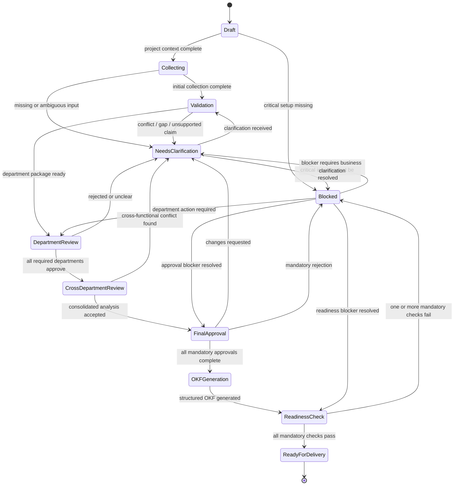

# Baspin Workflow State Machine

## Purpose

The workflow state machine defines how a Baspin project moves from initial business context to execution readiness.

The main rule is:

> **A project advances only when the required knowledge, ownership, validation, and approvals for that stage are complete.**

Baspin should never treat progress as a simple checklist completed by AI. Each transition must be tied to evidence, responsible owners, and explicit decision states.

---

## Top-Level Project States

1. `Draft`
2. `Collecting`
3. `Validation`
4. `Needs Clarification`
5. `Department Review`
6. `Cross-Department Review`
7. `Final Approval`
8. `OKF Generation`
9. `Readiness Check`
10. `Ready for Delivery`
11. `Blocked`

---

## State Definitions

### 1. Draft
The project exists but requirement collection has not started.

Required conditions:
- business goal defined
- scope entered
- Business Analyst assigned
- initial departments identified

Possible transitions:
- `Draft -> Collecting`
- `Draft -> Blocked` if mandatory setup information is missing and collection cannot start

---

### 2. Collecting
Baspin is gathering answers and evidence from departments and approved enterprise sources.

Activities:
- Question Agent generates department-specific questions
- stakeholders answer questions
- Evidence & Retrieval Agent gathers approved source material
- provenance is stored

Transition to `Validation` when:
- mandatory initial questions have responses or documented exceptions
- required evidence collection for the current iteration is complete

Transition to `Needs Clarification` when:
- a critical answer is incomplete
- an answer is ambiguous
- required source information is missing

---

### 3. Validation
The system compares answers, evidence, requirements, and sources.

Activities:
- detect contradictions
- detect missing information
- identify unsupported claims
- classify risks
- normalize preliminary requirements

Transition to `Needs Clarification` if:
- unresolved conflicts exist
- critical information is missing
- important claims have no accountable owner

Transition to `Department Review` if:
- department-level information is sufficiently complete
- no unresolved critical conflict prevents review

---

### 4. Needs Clarification
The project or a department package is waiting for additional human input.

Baspin should:
- identify exactly what is unclear
- route the question to the responsible owner
- preserve the previous answer and source trail
- avoid silently rewriting business truth

Possible transitions:
- `Needs Clarification -> Validation` after new information is submitted
- `Needs Clarification -> Blocked` when a required owner cannot or will not resolve a critical issue

---

### 5. Department Review
Each department reviews the knowledge and requirements attributed to its domain.

Department package may contain:
- confirmed answers
- normalized requirements
- supporting evidence
- open conflicts
- assumptions
- dependencies

Department decisions:
- Approved
- Rejected
- Needs Clarification

Transition to `Cross-Department Review` when:
- every mandatory department has approved its own package
- no critical department-owned conflict remains open

Transition back to `Needs Clarification` when:
- a department rejects or questions a critical requirement

---

### 6. Cross-Department Review
Baspin and the Business Analyst review interactions between departments.

Focus areas:
- conflicting requirements across functions
- duplicated responsibilities
- dependencies
- process handoffs
- data ownership
- legal/compliance/security impacts
- assumptions that affect more than one unit

Transition to `Final Approval` when:
- all critical cross-functional conflicts are resolved
- required department owners agree on shared requirements
- consolidated analysis is complete

Transition to `Needs Clarification` when:
- a new conflict or gap is discovered

---

### 7. Final Approval
The full consolidated business analysis is submitted for final human approval.

Required checks may include:
- Business Analyst final review
- relevant department owners
- Legal
- Compliance
- Security
- Finance
- project sponsor or designated authority

Transition to `OKF Generation` when:
- all mandatory final approvers approve
- no critical unresolved conflict exists

Transition to `Blocked` when:
- a mandatory approver rejects the project and no approved resolution path exists

Transition to `Needs Clarification` when:
- an approver requests changes or additional information

---

### 8. OKF Generation
Only approved business knowledge is converted into structured OKF.

Rules:
- unresolved conflicts must not be converted into final truth
- superseded requirements must remain traceable but not active
- OKF output must link back to approved requirement IDs
- provenance and approval metadata should be preserved

Transition to `Readiness Check` when:
- OKF artifact is generated successfully
- mandatory validation of the artifact is complete

---

### 9. Readiness Check
The system evaluates whether the project can enter Agile / SDLC execution.

Typical checks:
- business requirements: PASS
- data requirements: PASS
- legal: PASS
- compliance: PASS
- security: PASS
- finance: PASS or N/A
- technical feasibility: PASS
- stakeholder approval: PASS
- critical conflicts: NONE OPEN
- OKF artifact: APPROVED

Transition to `Ready for Delivery` when all mandatory checks pass.

Transition to `Blocked` when any mandatory check fails or is still pending.

---

### 10. Ready for Delivery
The project is approved to enter downstream execution.

This means Baspin has established that:
- required knowledge has been collected
- owners have confirmed their domain
- cross-functional conflicts are resolved
- final approvals exist
- structured OKF is available
- readiness checks pass

This state does not mean the implementation itself is complete. It means the project is ready to begin delivery work.

---

### 11. Blocked
`Blocked` is a controlled state, not an error state.

The project must include explicit blocking metadata:
- blocking reason
- responsible owner
- affected requirement or approval
- required next action
- date blocked

Examples:
- Legal has not approved data retention policy
- Security assessment is incomplete
- Claims and Finance disagree on settlement authority
- mandatory department owner has rejected a requirement

A blocked project may return to the appropriate prior state once the blocker is resolved.

---

## State Diagram



---

## Department-Level State Machine

Each department can progress independently until cross-department review.

```text
Not Started
   ↓
Questions Sent
   ↓
Responses Received
   ↓
Validation
   ↓
Needs Clarification ─────┐
   ↓                     │
Ready for Department Review
   ↓
Department Approved
```

If a department rejects a package:

```text
Department Review
   ↓
Rejected / Needs Clarification
   ↓
Questions / Evidence Updated
   ↓
Validation
   ↓
Department Review
```

---

## Transition Rules

### Rule 1 — AI cannot promote a project by itself
AI may recommend a transition, but mandatory human approvals must be recorded before the transition is committed.

### Rule 2 — Critical conflicts are blocking
A critical unresolved conflict prevents:
- department approval where relevant
- final approval
- readiness PASS

### Rule 3 — Department completion is independent but visible
One department may be approved while another remains pending.

Example:

```text
Claims              APPROVED
Fraud               APPROVED
Compliance          APPROVED
Legal               NEEDS CLARIFICATION
Finance             PENDING
IT                  APPROVED
```

The overall project remains unable to enter final approval if Legal and Finance are mandatory.

### Rule 4 — Revisions invalidate affected approvals
If a material requirement changes after approval, dependent approvals should be marked stale or require re-confirmation.

### Rule 5 — Superseded information is retained
A revised answer or requirement should not delete the previous version from the audit history.

### Rule 6 — Readiness is computed
`Ready for Delivery` should be produced by readiness logic, not manually typed by the Business Analyst.

---

## Material Change Logic

A change is considered material when it affects one or more of the following:
- business rule
- process behavior
- financial threshold
- data use
- regulatory obligation
- security requirement
- customer impact
- integration contract
- acceptance criteria

Material changes may automatically reopen:
- department review
- cross-department review
- final approval
- readiness checks

This prevents an old approval from being reused after the underlying requirement changed.

---

## Approval Dependency Example

Example requirement:

> Claims above $25,000 require supervisor approval.

Dependencies:
- Claims must confirm the operational rule
- Finance may confirm settlement impact
- Compliance may confirm control requirements
- IT may confirm implementation feasibility

If the threshold changes from `$25,000` to `$50,000` after approval, Baspin should mark the affected approvals as requiring revalidation.

---

## Workflow Event Log

Every transition should create an auditable event.

Suggested fields:
- `event_id`
- `project_id`
- `from_state`
- `to_state`
- `reason`
- `triggered_by`
- `approved_by`
- `timestamp`
- `related_entity_ids`

Example:

```text
from_state: Department Review
to_state: Needs Clarification
reason: Legal rejected data-retention requirement
triggered_by: Legal Department Owner
related_requirement: REQ-LEGAL-014
```

---

## MVP Workflow

For the first working version, Baspin can implement a simplified project flow:

```text
Draft
  ↓
Collecting
  ↓
Validation
  ↓
Department Review
  ↓
Cross-Department Review
  ↓
Final Approval
  ↓
OKF Generation
  ↓
Readiness Check
  ↓
Ready for Delivery
```

`Needs Clarification` and `Blocked` should be available as side states from the first MVP because they are essential to the check-and-balance model.

---

## Core Workflow Principle

Baspin should optimize for **trustworthy progression**, not fast progression.

The system should make it easy to see:
- what is known
- what is unverified
- what is disputed
- who owns the answer
- who approved it
- what is blocking the project
- what must happen next

That visibility is what protects the Business Analyst and makes the final structured knowledge trustworthy enough for downstream Agile / SDLC execution.
