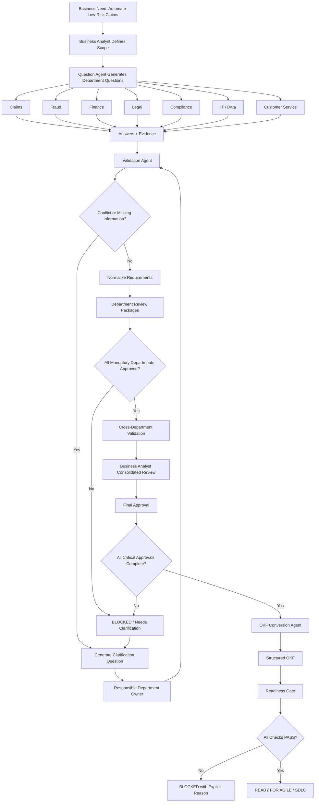

# Baspin Insurance Use Case — Automated Claim Approval

## Purpose

This use case is the first end-to-end test scenario for Baspin.

The objective is to evaluate whether Baspin can guide a Business Analyst through a realistic insurance project by:

- identifying the right departments
- generating the right questions for each department
- collecting answers and company evidence
- detecting conflicts and missing information
- routing clarification requests to responsible owners
- obtaining department-level approval
- consolidating cross-functional requirements
- obtaining final approval
- converting validated knowledge into OKF
- determining whether the project is ready for Agile / SDLC execution

The scenario is intentionally designed to include conflicting information so that the check-and-balance model can be tested.

---

## Scenario

An insurance company wants to automate the approval of low-risk claims in order to reduce manual processing time and improve customer response speed.

Today, claim decisions are handled through a combination of:

- manual Claims review
- fraud checks
- policy rules
- financial approval thresholds
- compliance requirements
- existing claims systems

The proposed project will introduce an automated decision workflow for claims that meet approved business, risk, legal, financial, and technical conditions.

---

## Initial Business Need

### Project Name
Automated Claim Approval

### Business Goal
Reduce manual processing for eligible low-risk claims while preserving fraud, financial, regulatory, legal, and operational controls.

### Initial Success Criteria
- reduce manual claim review volume
- reduce average decision time
- maintain required fraud controls
- prevent unauthorized claim payments
- preserve auditability
- preserve regulatory and legal controls
- ensure every automated decision can be explained and traced

---

## Initial Scope

### In Scope
- claim eligibility rules
- automatic approval thresholds
- fraud screening
- payment authorization rules
- required customer and policy data
- exception handling
- audit trail requirements
- legal and compliance constraints
- system integration requirements

### Out of Scope for MVP
- full claim payment execution
- complex litigation claims
- catastrophic claims
- new policy underwriting
- customer-facing chatbot functionality

---

## Departments

The Business Analyst starts with the following departments:

1. Claims Operations
2. Fraud / Special Investigations
3. Finance
4. Legal
5. Compliance
6. IT / Engineering
7. Data / Analytics
8. Customer Service
9. Product / Insurance Operations

Baspin may recommend additional departments if answers reveal new dependencies.

---

# Phase 1 — Question Generation

Baspin's Question Agent generates questions by department.

## Claims Operations

Core questions:

1. Which claim types are candidates for automatic approval?
2. Which claim types must always receive manual review?
3. What claim amount can be approved automatically?
4. Which conditions require supervisor approval?
5. What operational exceptions exist today?
6. Which claim data must be present before a decision can be made?
7. What reasons should automatically prevent approval?
8. What happens when claim information is incomplete?
9. Who owns the final operational rule set?
10. Which existing SOP or procedure documents these rules?

Expected owner:
- Claims Manager / Claims Operations Owner

---

## Fraud / Special Investigations

Core questions:

1. Which fraud indicators should block automatic approval?
2. Which signals require manual review rather than rejection?
3. Are there existing fraud scores or thresholds?
4. Which data sources feed fraud decisions?
5. Are there high-risk claim categories that must never be automated?
6. What happens if the fraud service is unavailable?
7. Who owns fraud-rule approval?
8. Which rules are regulatory versus internally defined?

Expected owner:
- Fraud / SIU Manager

---

## Finance

Core questions:

1. What payment value can be approved without additional financial authorization?
2. Are payment thresholds different from claim approval thresholds?
3. Which financial controls must be completed before payment authorization?
4. Are there reserve or reconciliation rules that affect automation?
5. Which payment methods have different approval requirements?
6. Which financial records must be retained for audit?
7. Who owns approval of financial thresholds?

Expected owner:
- Finance Operations / Controller representative

---

## Legal

Core questions:

1. Which claim decisions require human review for legal reasons?
2. What documentation must be retained for automated decisions?
3. Are explanation requirements applicable to automated decisions?
4. What data-retention period applies?
5. Which jurisdictions impose additional requirements?
6. What legal constraints apply to decision automation?
7. Which decisions could increase litigation risk?
8. Who has final legal approval authority?

Expected owner:
- Legal Counsel assigned to Claims / Insurance Operations

---

## Compliance

Core questions:

1. Which regulatory controls must execute before automatic approval?
2. What audit evidence is required?
3. Which approvals or disclosures must be recorded?
4. Which states or jurisdictions have special requirements?
5. What should happen if a required compliance check cannot be completed?
6. Which compliance rules are blocking versus advisory?
7. Who owns regulatory sign-off?

Expected owner:
- Compliance Officer / Regulatory Operations

---

## IT / Engineering

Core questions:

1. Which systems currently contain claim, policy, customer, fraud, and payment data?
2. Which APIs are available?
3. Which systems are systems of record?
4. What happens when an upstream service is unavailable?
5. Which actions are synchronous versus asynchronous?
6. What integration dependencies exist?
7. What technical constraints affect real-time approval?
8. What audit events can the existing systems record?
9. Which technical requirements could block the MVP?

Expected owner:
- Engineering Lead / Claims Platform Owner

---

## Data / Analytics

Core questions:

1. Which data fields are required for eligibility decisions?
2. How complete and reliable are those fields?
3. Which fields have known quality issues?
4. What historical data exists for evaluating automation rules?
5. Which metrics should monitor decision quality?
6. How should false approvals and false escalations be measured?
7. What data lineage must be retained?

Expected owner:
- Data Lead / Analytics Lead

---

## Customer Service

Core questions:

1. What information must be communicated to customers after a decision?
2. What happens when a claim is sent to manual review?
3. What explanation should customers receive for delays?
4. Which customer inquiries increase after claim decisions?
5. What escalation path should exist?

Expected owner:
- Customer Service Operations Manager

---

# Phase 2 — Evidence Collection

Baspin attempts to retrieve or register relevant evidence from approved company sources.

Example evidence:

| Evidence ID | Source | Example Information |
|---|---|---|
| E-001 | Claims SOP v3.1 | Claims <= $25,000 may qualify for automatic processing |
| E-002 | Claims Policy v2.1 | Automatic approval threshold = $20,000 |
| E-003 | Fraud Rules Service | Fraud score >= 80 requires manual investigation |
| E-004 | Finance Control Matrix | Payments > $15,000 require finance authorization |
| E-005 | Legal Retention Policy | Automated decision records retained for 7 years |
| E-006 | Claims API Documentation | Claim status, amount, coverage, incident date available via API |
| E-007 | Compliance Checklist | Sanctions and identity controls required before payment |

Important:

Baspin stores these as evidence, not automatically as final truth.

---

# Phase 3 — Example Stakeholder Answers

For the test scenario, assume the following answers are received.

## Claims Answer

> Claims up to $25,000 can be automatically approved if coverage is valid, all required documents are present, and no fraud or exception flag exists.

Provided by:
- Claims Manager

Status:
- Submitted

---

## Fraud Answer

> Any fraud score of 80 or above must be routed to manual investigation. Certain claim categories must also be manually reviewed regardless of score.

Provided by:
- Fraud Manager

Status:
- Submitted

---

## Finance Answer

> Any payment above $15,000 requires Finance authorization before funds are released.

Provided by:
- Finance Operations Manager

Status:
- Submitted

---

## Legal Answer

> Automated decisions must preserve decision evidence, applicable rules, source data references, and the responsible process version for seven years.

Provided by:
- Legal Counsel

Status:
- Submitted

---

# Phase 4 — Conflict Detection

Baspin detects the following conflicts and dependencies.

## Conflict C-001 — Claims Threshold Conflict

Evidence:
- Claims SOP v3.1: $25,000
- Claims Policy v2.1: $20,000
- Claims Manager: $25,000

Severity:
- High

Reason:
- A production automation rule cannot safely choose between an operational SOP and an older policy without explicit confirmation.

Baspin-generated clarification:

> Claims Operations currently states that claims up to $25,000 may be automatically approved, while Claims Policy v2.1 states $20,000. Which threshold is authoritative for this project, and does the policy require formal update before implementation?

Owner:
- Claims Manager

Possible resolution:

> $25,000 is the approved current operational threshold. Claims Policy v2.1 is outdated and must be replaced before production go-live.

Result:
- operational requirement may proceed
- policy update becomes a tracked dependency

---

## Conflict / Dependency C-002 — Claim Approval vs Payment Authorization

Claims rule:
- claims up to $25,000 may qualify for automatic approval

Finance rule:
- payments above $15,000 require Finance authorization

This is not necessarily a contradiction.

Baspin should distinguish:

```text
Claim Decision Approval != Payment Release Approval
```

Clarification question:

> Can a $20,000 claim be automatically approved while its payment release remains pending Finance authorization?

Expected resolution:

> Yes. Claim eligibility and payment authorization are separate process steps.

Normalized rules:

1. Eligible claim may be automatically approved up to $25,000.
2. Payment release above $15,000 requires Finance authorization.

This is an example of why Baspin must understand process semantics rather than simply comparing numbers.

---

# Phase 5 — Requirement Normalization

After clarification, Baspin creates candidate requirements.

## REQ-CLAIMS-001

Type:
- Business Rule

Requirement:

> A claim may be automatically approved only when the claim amount is less than or equal to $25,000, required documentation is complete, policy coverage is valid, and no blocking fraud or exception condition exists.

Owner:
- Claims Operations

Sources:
- Claims Manager answer
- SOP v3.1
- resolved conflict C-001

Status:
- Department Review

---

## REQ-FRAUD-001

Type:
- Business Rule / Risk Control

Requirement:

> A claim with a fraud score of 80 or higher must not be automatically approved and must be routed to manual investigation.

Owner:
- Fraud

Status:
- Department Review

---

## REQ-FIN-001

Type:
- Financial Control

Requirement:

> Claim payment release above $15,000 requires Finance authorization even when the claim decision itself is automatically approved.

Owner:
- Finance

Status:
- Department Review

---

## REQ-LEGAL-001

Type:
- Legal / Audit Requirement

Requirement:

> Each automated claim decision must preserve the decision result, evaluated business-rule version, relevant source-data references, and decision evidence for seven years.

Owner:
- Legal

Status:
- Department Review

---

## REQ-SYS-001

Type:
- Integration Requirement

Requirement:

> The automated claim decision workflow must retrieve required policy, claim, fraud, and payment-control information from approved systems of record before returning a final automation decision.

Owner:
- IT / Engineering

Status:
- Department Review

---

# Phase 6 — Department Review

Baspin creates separate review packages.

Example status dashboard:

```text
Claims Operations      APPROVED
Fraud                  APPROVED
Finance                APPROVED
Legal                  APPROVED
Compliance             NEEDS CLARIFICATION
IT / Engineering       APPROVED
Data / Analytics       APPROVED
Customer Service       PENDING
```

Overall status:

```text
NOT READY FOR FINAL APPROVAL
```

Reasons:
1. Compliance has an unresolved jurisdiction question.
2. Customer Service has not confirmed customer notification requirements.

This is the check-and-balance behavior Baspin must enforce.

---

# Phase 7 — Cross-Department Validation

The Business Analyst and Consolidation Agent review interactions between approved requirements.

Cross-functional checks include:

- Claims threshold vs Finance threshold
- fraud routing vs customer communication
- Legal retention vs technical storage capability
- Compliance controls vs real-time decision latency
- Data requirements vs existing API availability
- exception flows vs Customer Service escalation

Baspin should produce a consolidated analysis with:

- confirmed business rules
- dependencies
- risks
- unresolved items
- assumptions
- owners
- approval status

---

# Phase 8 — Final Approval

Once all mandatory department packages are approved, Baspin prepares a final approval package.

Example:

```text
Claims                  APPROVED
Fraud                   APPROVED
Finance                 APPROVED
Legal                   APPROVED
Compliance              APPROVED
Security                APPROVED
IT                      APPROVED
Data                    APPROVED
Customer Service        APPROVED
Business Analyst Review APPROVED
```

Final status:

```text
APPROVED FOR OKF CONVERSION
```

---

# Phase 9 — Example OKF Transformation

A simplified representation might contain:

```yaml
project:
  id: automated-claim-approval
  goal: reduce manual processing for eligible low-risk claims

actors:
  - claims_operations
  - fraud
  - finance
  - legal
  - compliance
  - engineering

business_rules:
  - id: REQ-CLAIMS-001
    rule: claim_amount <= 25000
    conditions:
      - coverage_valid == true
      - required_documents_complete == true
      - blocking_fraud_flag == false
      - blocking_exception == false
    owner: claims_operations
    approval_status: approved

  - id: REQ-FRAUD-001
    rule: fraud_score >= 80
    action: manual_investigation
    owner: fraud
    approval_status: approved

  - id: REQ-FIN-001
    rule: payment_amount > 15000
    action: finance_authorization_required
    owner: finance
    approval_status: approved

controls:
  - id: REQ-LEGAL-001
    retention_years: 7
    preserve:
      - decision_result
      - rule_version
      - source_data_references
      - decision_evidence

process:
  - validate_required_data
  - validate_policy_coverage
  - execute_fraud_controls
  - evaluate_claim_eligibility
  - evaluate_payment_authorization
  - record_decision_provenance
  - route_exception_if_required
```

This is only an example representation; the final OKF schema will be defined separately.

---

# Phase 10 — Project Readiness Gate

Example final gate:

| Check | Status |
|---|---|
| Business Requirements | PASS |
| Claims Approval | PASS |
| Fraud Controls | PASS |
| Finance Controls | PASS |
| Legal | PASS |
| Compliance | PASS |
| Security | PASS |
| Data Requirements | PASS |
| Technical Feasibility | PASS |
| Stakeholder Approval | PASS |
| Critical Conflicts | PASS — none open |
| OKF Artifact | PASS |

Project status:

```text
READY FOR DELIVERY
```

The project may now enter Agile / SDLC execution.

---

# End-to-End Use Case Flow



---

# What This Use Case Tests

This use case is successful if Baspin demonstrates that it can:

1. generate differentiated questions for different departments
2. combine stakeholder answers with company evidence
3. preserve source provenance
4. detect real contradictions
5. distinguish contradiction from process dependency
6. generate targeted clarification questions
7. retain human ownership of business facts
8. prevent AI from self-approving requirements
9. block progression while mandatory approvals are missing
10. invalidate or revisit approvals after material changes
11. create traceable normalized requirements
12. generate OKF only from approved knowledge
13. compute readiness based on explicit gates
14. provide the Business Analyst with a defensible audit trail

---

## Next Implementation Step

The next design artifact should define the **agent logic and prompt contracts** used to execute this use case:

- Question Agent contract
- Evidence Agent contract
- Validation Agent contract
- Conflict Detection contract
- Consolidation Agent contract
- OKF Conversion Agent contract
- Readiness Agent contract

These contracts will become the behavioral specification for the first Baspin prototype.
