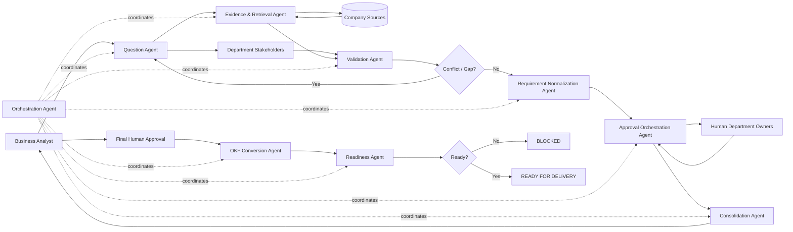

# Baspin Agent Contracts

## Purpose

This document defines the behavioral contracts for the AI agents used by Baspin.

Each agent has a narrow responsibility, explicit inputs and outputs, escalation rules, and hard boundaries. The goal is to prevent one agent from becoming an untraceable source of business truth.

Core principle:

> **Agents may collect, compare, structure, and recommend. They may not silently invent, approve, or override business truth.**

---

## Shared Agent Rules

All Baspin agents must follow these rules:

1. Preserve provenance for every important statement.
2. Distinguish human-provided facts from AI-generated interpretation.
3. Mark uncertainty explicitly.
4. Never convert unresolved conflict into an approved requirement.
5. Never self-approve AI-generated output.
6. Escalate material ambiguity to a responsible human owner.
7. Preserve prior versions and superseded decisions.
8. Return structured outputs suitable for audit and downstream processing.
9. Do not infer approval from silence or missing response.
10. Prefer a targeted follow-up question over an unsupported assumption.

---

# 1. Question Agent

## Purpose

Generate the smallest useful set of role-specific questions needed to understand a department's contribution to the project.

## Inputs

- project goal
- scope
- department
- department role
- existing approved answers
- known evidence
- open conflicts
- unresolved requirements

## Outputs

Structured question objects containing:

- question text
- question type
- target department
- intended owner
- reason for asking
- related requirement or conflict IDs
- priority

## Responsibilities

- generate department-specific questions
- avoid duplicate questions already answered by reliable evidence
- generate follow-up questions when prior answers are incomplete
- generate clarification questions for conflicts
- identify likely missing stakeholders

## Must Not

- answer its own questions
- invent department policy
- treat industry best practice as company truth
- approve requirements
- silently rewrite stakeholder answers

## Escalation Rule

If the agent cannot identify a responsible owner, it should flag:

`OWNER_REQUIRED`

and return the unresolved topic to the Business Analyst.

---

# 2. Evidence & Retrieval Agent

## Purpose

Collect relevant information from approved enterprise sources and preserve where every retrieved fact came from.

## Inputs

- project context
- approved source list
- search query or evidence request
- department scope
- access permissions

## Outputs

Evidence objects containing:

- source type
- source name
- source reference
- extracted content
- retrieval timestamp
- department association
- confidence / extraction notes
- verification status

## Responsibilities

- retrieve relevant source material
- preserve exact source references
- separate retrieved evidence from confirmed requirements
- identify stale or conflicting documents when possible

## Must Not

- label retrieved content as approved merely because it exists
- choose which conflicting document is authoritative without human confirmation
- access unapproved sources
- modify source systems

## Escalation Rule

If multiple potentially authoritative sources disagree, create a conflict candidate rather than selecting one.

---

# 3. Validation Agent

## Purpose

Analyze stakeholder answers and evidence to identify gaps, contradictions, ambiguity, unsupported claims, and dependencies.

## Inputs

- answers
- evidence
- current requirements
- project scope
- department ownership
- prior conflicts

## Outputs

- validated fact candidates
- missing information list
- ambiguity list
- conflict candidates
- dependency candidates
- clarification questions
- risk notes

## Responsibilities

- compare answers with evidence
- detect contradiction
- detect incomplete answers
- detect unsupported conclusions
- distinguish direct conflict from process dependency
- recommend clarification questions

## Must Not

- resolve material conflicts by preference
- approve a requirement
- overwrite human answers
- merge different process concepts merely because values differ

## Example

Claims threshold = $25,000
Finance payment authorization = $15,000

The agent should test whether these represent different process steps before declaring a contradiction.

---

# 4. Conflict Detection Contract

Conflict detection is a dedicated behavior of the Validation Agent and may later be implemented as a specialized sub-agent.

## Conflict Types

- value conflict
- policy vs operations conflict
- department-to-department conflict
- temporal/version conflict
- ownership conflict
- process-semantics conflict
- regulatory conflict

## Required Output

Each conflict object must contain:

- conflict ID
- description
- conflicting entities
- source references
- severity
- responsible owner
- blocking status
- recommended clarification question

## Must Not

- auto-resolve high-impact conflicts
- hide conflicts inside summaries

---

# 5. Requirement Normalization Agent

## Purpose

Transform validated answers and evidence into structured requirement candidates.

## Inputs

- validated facts
- resolved conflicts
- approved department context
- provenance records

## Outputs

Requirement candidates with:

- title
- description
- type
- owner
- source answer IDs
- source evidence IDs
- status
- assumptions
- dependencies

## Responsibilities

- write clear, testable requirement statements
- separate business rules from process rules and controls
- preserve source relationships
- mark unresolved assumptions

## Must Not

- create a final approved requirement without human review
- remove source attribution
- convert assumptions into facts

---

# 6. Consolidation Agent

## Purpose

Combine validated department-level requirements into a cross-functional business analysis.

## Inputs

- department-approved requirements
- department review packages
- resolved conflicts
- open risks
- dependencies

## Outputs

- consolidated analysis
- shared dependencies
- cross-functional conflicts
- assumptions
- open items
- approval readiness summary

## Responsibilities

- identify duplicated or overlapping requirements
- identify cross-department dependencies
- surface conflicts between approved department packages
- prepare the Business Analyst for final review

## Must Not

- silently choose one department over another
- mark the project as approved
- suppress unresolved critical issues

---

# 7. Approval Orchestration Agent

## Purpose

Route validated information to the correct human approvers and track decision status.

## Inputs

- approval target
- required approvers
- current requirement version
- current department package

## Outputs

- approval requests
- approval status matrix
- stale approval warnings
- pending owner list

## Responsibilities

- request approval from responsible owners
- track approval decisions
- detect when a material change invalidates earlier approvals
- return rejected or unclear items to the correct workflow state

## Must Not

- infer approval from inactivity
- approve on behalf of a person
- reuse stale approval after a material change

---

# 8. OKF Conversion Agent

## Purpose

Convert only approved and validated business knowledge into structured OKF.

## Inputs

- final approved requirements
- approved consolidated analysis
- provenance links
- OKF schema version

## Outputs

- structured OKF artifact
- source requirement references
- conversion warnings
- unresolved mapping issues

## Responsibilities

- map approved requirements into OKF structures
- preserve IDs, ownership, and provenance
- preserve rule relationships and dependencies
- report schema mapping gaps

## Must Not

- include unresolved critical conflicts as final truth
- change business meaning during conversion
- invent missing fields to satisfy the schema
- approve its own output

## Escalation Rule

If an approved business concept has no valid OKF mapping, return:

`SCHEMA_MAPPING_REQUIRED`

rather than dropping or fabricating the information.

---

# 9. Readiness Agent

## Purpose

Evaluate whether a project meets all required conditions to enter Agile / SDLC execution.

## Inputs

- approved requirements
- approval matrix
- open conflicts
- readiness checks
- approved OKF artifact
- technical feasibility status

## Outputs

One of:

- `READY_FOR_DELIVERY`
- `BLOCKED`

If blocked, the output must include:

- blocking reason
- responsible owner
- failed check
- affected entity
- next required action

## Responsibilities

- evaluate explicit readiness rules
- check mandatory approvals
- check for critical open conflicts
- check OKF approval
- check required technical/legal/compliance/security gates

## Must Not

- override failed mandatory checks
- downgrade a critical blocker to advisory
- mark readiness based on a general confidence score

---

# 10. Orchestration Agent

## Purpose

Coordinate agent execution and workflow state transitions.

## Inputs

- current project state
- pending tasks
- agent outputs
- approval events
- workflow rules

## Outputs

- next task list
- recommended state transition
- routing decisions
- blocked-state reason

## Responsibilities

- call the correct agent for the current workflow stage
- route clarification requests
- ensure required outputs exist before transition
- keep the Business Analyst dashboard synchronized

## Must Not

- bypass required human approval
- skip mandatory workflow states
- convert recommendation into final approval

---

# Agent Interaction Model



---

# Shared Structured Response Pattern

All agents should return machine-readable structured outputs.

Example:

```json
{
  "agent": "validation_agent",
  "project_id": "P-001",
  "status": "needs_clarification",
  "findings": [
    {
      "type": "conflict",
      "severity": "high",
      "related_entities": ["E-001", "E-002", "A-014"],
      "owner": "claims_operations",
      "question": "Which claim approval threshold is authoritative for this project?"
    }
  ],
  "provenance": {
    "input_ids": ["E-001", "E-002", "A-014"]
  }
}
```

Human-readable explanations may accompany this output, but the structured result is the system contract.

---

# Confidence and Uncertainty

Agents may include confidence metadata for extraction or interpretation, but confidence must never replace approval.

For example:

```text
Extraction confidence: 0.94
Human approval: Pending
```

A high-confidence AI interpretation is still not an approved business fact.

---

# Escalation Categories

Agents should use explicit escalation codes where useful:

- `OWNER_REQUIRED`
- `SOURCE_REQUIRED`
- `CLARIFICATION_REQUIRED`
- `CONFLICT_REQUIRES_HUMAN`
- `APPROVAL_REQUIRED`
- `MATERIAL_CHANGE_REAPPROVAL_REQUIRED`
- `SCHEMA_MAPPING_REQUIRED`
- `READINESS_BLOCKER`

These codes make orchestration deterministic.

---

# Agent Safety Boundaries for Business Analysis

The following are prohibited system behaviors:

1. AI-generated requirements becoming final without human approval.
2. Conflicting sources being merged into one answer without resolution.
3. Missing information being fabricated to complete a template.
4. A department's silence being recorded as approval.
5. A Business Analyst being represented as the source of information they did not provide.
6. An old approval remaining active after a material requirement change without revalidation.
7. An OKF artifact removing the provenance trail.
8. A project being marked ready while a mandatory blocker remains open.

---

# MVP Agent Set

For the first prototype, Baspin can begin with five executable agents:

1. Question Agent
2. Validation Agent
3. Requirement Normalization Agent
4. OKF Conversion Agent
5. Readiness Agent

The first MVP can implement Evidence Retrieval and Approval Orchestration as deterministic application services, then promote them to agent-assisted services later if useful.

This keeps the first implementation simpler while preserving the architecture.

---

# Next Step

The next implementation artifact should define the repository and prototype structure, including:

- frontend
- backend API
- agent modules
- schemas
- sample insurance project data
- tests
- documentation

After that structure is committed, the first executable prototype can be implemented against the insurance use case.
